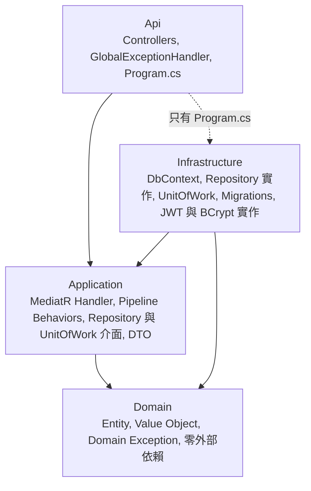
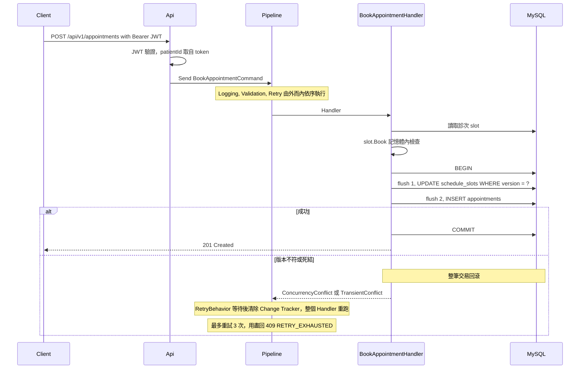

# MedConnect

[](https://github.com/xp660/MedConnect/actions/workflows/ci.yml)

MedConnect 是一個診所預約的 Backend API（.NET 9、ASP.NET Core、EF Core、MySQL 8）：病人登入後可以查詢醫生的可預約診次、預約、取消。這是個人的學習與作品集專案，用來練習並展示 Clean Architecture、CQRS（MediatR）、JWT 與**樂觀鎖併發控制**，不是營運中的系統。

**最大的技術亮點：50 位病人同時搶一個容量 5 的診次。** 用真實 MySQL（Testcontainers）實測：沒有重試時平均只成功 1.5 位；加上有界重試（最多 3 次）後，60 輪全部恰好成功 5 位，沒有超賣、`schedule_slots` 與 `appointments` 兩表沒有 drift。這是機率性的保證而不是確定性的，細節與限制見[併發驗證結果](#6-併發驗證結果)。

專案的範圍刻意限定在四支 API：Login、Schedule Query、Concurrent Booking、Cancel Appointment。

## 目錄

1. [快速開始](#1-快速開始)
2. [用 curl 走一遍完整流程](#2-用-curl-走一遍完整流程)
3. [架構](#3-架構)
4. [核心設計決策](#4-核心設計決策)
5. [技術選擇](#5-技術選擇)
6. [併發驗證結果](#6-併發驗證結果)
7. [測試策略](#7-測試策略)
8. [API 參考與 errorCode](#8-api-參考與-errorcode)
9. [已知限制與刻意延後的決定](#9-已知限制與刻意延後的決定)
10. [文件](#10-文件)

---

## 1. 快速開始

需要 Docker 與 Docker Compose v2（`docker compose` 指令）。

```bash
git clone https://github.com/xp660/MedConnect.git
cd MedConnect
cp .env.example .env
docker compose up -d --build
```

第一次會下載基底映像並建置 API 映像，比較久。`docker compose up -d` 一回到提示字元，API 容器雖然已經啟動，但還在套用 migration 與建立示範資料，port 還沒真正可用（實測立刻 `curl` 會得到空回應，約 4 秒後才好）。用這一行等它好：

```bash
for i in $(seq 1 60); do curl -sf http://localhost:8080/health && break; sleep 1; done; echo
# Healthy
```

如果等了 60 秒仍然沒有輸出，看 `docker compose logs api`。

- `docker compose up` 會同時起 MySQL 與 API；`docker compose up mysql` 只起 MySQL。
- API 在 MySQL 健康之後才啟動，啟動時會自動套用 migration 並建立示範資料（見下）。
- 看 API 日誌：`docker compose logs -f api`（容器是 Production 環境，一行一個 JSON）。
- 停止：`docker compose down`。連資料一起清掉重來：`docker compose down -v`。
- 兩個主機 port（MySQL 13306、API 8080）都只綁在 `127.0.0.1`，區域網路連不到。MySQL 刻意用 13306 避開本機 MySQL 常用的 3306；這個 port 只影響你從主機連資料庫，API 是走 compose 內部網路連 MySQL 的。

### 示範帳號

| | |
|---|---|
| Email | `test-patient@medconnect.local` |
| 密碼 | `Test1234!` |

這個帳號**只因為 compose 把 `Database:SeedDemoData` 打開才存在**，密碼是寫在原始碼裡的公開值，**僅供本機展示**。這個設定預設是 `false`：沒有明確打開的環境不會 migrate、也不會建立任何示範帳號（見[核心設計決策](#4-核心設計決策)）。啟用時 API 會記一行 Warning 提醒。

示範資料是兩位醫生（`doctorId` 為 `1` 與 `2`），各有「啟動當天起第 1、2、3 天的 UTC 09:00」三個診次，容量都是 5。

### 常見問題

**Port 被佔用。** MySQL 預設用 13306、API 用 8080，任何一個被佔用，症狀都是啟動容器時出現 bind 失敗的錯誤，字眼依平台而異，例如 `Bind for 127.0.0.1:8080 failed: port is already allocated`（被別的容器佔用）或 `ports are not available: … bind: Only one usage of each socket address …`（被本機程式佔用，Windows 上的 Docker Desktop）。做法：編輯 `.env`——把 `MYSQL_PORT` 改成沒被佔用的值；API 的 port 則把檔案末尾註解掉的 `# API_PORT=8080` 取消註解並改值——再重新 `docker compose up -d`：

```
MYSQL_PORT=13307
API_PORT=18080
```

之後 curl 的網址要跟著改成 `API_PORT`。

**示範診次過期，預約一直回 `SLOT_NOT_BOOKABLE`。** 示範資料只在資料庫還沒有任何醫生時建立一次，而診次只涵蓋啟動當天起的 1 到 3 天，所以 volume 放了幾天之後診次就會全部過期。用 `docker compose down -v` 清掉 volume 重來。

**舊的 volume 搭配不同的密碼。** `.env` 裡的資料庫密碼只在「全新 volume 第一次初始化」時生效。如果 volume 是用別的密碼建立的，API 會啟動失敗，`docker compose logs api` 可以看到 `Access denied for user 'medconnect'`（MySQL 本身仍顯示 healthy）。沿用當初的密碼，或用 `docker compose down -v` 重建（資料會清空）。

**API 啟動就結束。** 先看 `docker compose logs api`。常見的原因是 `.env` 沒有建立，或缺少 `JWT_SECRET_KEY`：啟動時會驗證密鑰存在且至少 32 個 UTF-8 位元組，不符就以一行 `Fatal` 日誌結束。

---

## 2. 用 curl 走一遍完整流程

容器是 Production 環境，**OpenAPI 端點只在 Development 才開**，所以這一節與[第 8 節](#8-api-參考與-errorcode)就是這支 API 的文件。以下指令用 bash 寫（Linux、macOS、WSL、Git Bash），回應是實際執行的結果，`<TOKEN>` 是佔位符，時間戳與 `traceId` 每次不同。

網址以預設的 8080 為例；如果改過 `API_PORT`，請自行替換。帶 `-i` 的回應只節錄與本文相關的 header。

### 2.1 Login

```bash
curl -s -X POST http://localhost:8080/api/v1/auth/login \
  -H "Content-Type: application/json" \
  -d '{"email":"test-patient@medconnect.local","password":"Test1234!"}'
```

```json
{"accessToken":"<TOKEN>","tokenType":"Bearer","expiresIn":3600}
```

把 token 存進變數（不依賴 `jq`）：

```bash
TOKEN=$(curl -s -X POST http://localhost:8080/api/v1/auth/login \
  -H "Content-Type: application/json" \
  -d '{"email":"test-patient@medconnect.local","password":"Test1234!"}' \
  | sed -n 's/.*"accessToken":"\([^"]*\)".*/\1/p')
```

### 2.2 查詢可預約診次（不需要登入）

日期是 UTC 的 `YYYY-MM-DD`。示範診次在「今天起 1 到 3 天」的 09:00 UTC，下面用明天（GNU `date`；其他系統請自行填入明天的日期）：

```bash
curl -s "http://localhost:8080/api/v1/schedule-slots?doctorId=1&date=$(date -u -d '+1 day' +%F)"
```

```json
[{"id":1,"doctorId":1,"startUtc":"2026-10-18T09:00:00+00:00","capacity":5,"availableCount":5,"status":"Open"}]
```

記下 `id`（診次編號）。沒有診次的日期回 `200` 與 `[]`；不存在的 `doctorId` 回 `404 DOCTOR_NOT_FOUND`。

### 2.3 預約

```bash
curl -s -i -X POST http://localhost:8080/api/v1/appointments \
  -H "Authorization: Bearer $TOKEN" \
  -H "Content-Type: application/json" \
  -d '{"slotId":1}'
```

```
HTTP/1.1 201 Created
Content-Type: application/json; charset=utf-8
Location: /api/v1/appointments/1

{"appointmentId":1,"slotId":1,"patientId":1,"status":0,"bookedAtUtc":"2026-10-17T12:45:07.2826275Z"}
```

病人編號 `patientId` 取自 token，不接受 request body 傳入。`status` 是數字：`0` = Booked、`1` = Cancelled。再查一次診次，`availableCount` 變成 `4`。

同一位病人重複預約同一個診次，回 `409 DUPLICATE_BOOKING`：

```json
{"title":"DUPLICATE_BOOKING","status":409,"detail":"Patient 1 already has an active booking for schedule slot 1.","errorCode":"DUPLICATE_BOOKING","traceId":"0HNPC9HLQ9J71:00000001"}
```

### 2.4 取消

```bash
curl -s -i -X POST http://localhost:8080/api/v1/appointments/1/cancel \
  -H "Authorization: Bearer $TOKEN"
```

```
HTTP/1.1 200 OK
Content-Type: application/json; charset=utf-8

{"appointmentId":1,"status":1,"cancelledAtUtc":"2026-10-17T12:45:08.3365721Z"}
```

取消後名額釋放（`availableCount` 回到 `5`）。再取消一次，回 `409 ALREADY_CANCELLED`；取消不存在、或不屬於自己的預約，都回同一個 `404 APPOINTMENT_NOT_FOUND`（避免從回應推測別人的預約是否存在）。

### 2.5 錯誤回應的形狀

所有被對映的錯誤都是 `application/problem+json`，帶 `errorCode` 與 `traceId`。輸入驗證失敗（`400`）多一個 `errors`（欄位 → 訊息陣列）：

```bash
curl -s -X POST http://localhost:8080/api/v1/appointments \
  -H "Authorization: Bearer $TOKEN" -H "Content-Type: application/json" -d '{"slotId":0}'
```

```json
{"title":"VALIDATION_FAILED","status":400,"detail":"One or more validation errors occurred.","errorCode":"VALIDATION_FAILED","traceId":"0HNPC9HLQ9J7A:00000001","errors":{"slotId":["must be greater than 0"]}}
```

沒帶 token（或 token 無效）打需要登入的端點，回 `401`，沒有 body，只有 `WWW-Authenticate: Bearer` header。

---

## 3. 架構

四層 Clean Architecture，依賴方向由外向內。`Api` 引用 `Infrastructure` 只為了 `Program.cs`（Composition Root）：DI 註冊、啟動時的 migrate／seed、JWT 設定要用到的 `JwtOptions`；`Api` 其餘程式碼不使用 Infrastructure 的型別。



依賴規則由 `MedConnect.ArchitectureTests`（NetArchTest）自動檢查，見[測試策略](#7-測試策略)。

一次預約請求（`POST /api/v1/appointments`）怎麼走：



- Pipeline 的順序是 `LoggingBehavior` → `ValidationBehavior` → `RetryBehavior`（註冊順序即由外而內的執行順序）。驗證失敗的請求不會進入重試迴圈。
- `slot.Book()` 在交易之外先做一次記憶體檢查（已滿、已關閉、已開始就直接拒絕，不開交易）；真正擋住併發的是 `UPDATE … WHERE version = ?` 影響列數為 0。
- 兩次 flush 在同一筆顯式交易裡，順序固定（先 `schedule_slots` 再 `appointments`）；原因見設計決策。
- `SlotFull`、`DuplicateBooking`、`AlreadyCancelled` 這類業務結果不會被重試，直接由 `GlobalExceptionHandler` 對映成 409。

專案結構：

```
src/    MedConnect.Domain / Application / Infrastructure / Api
tests/  Domain.UnitTests / Application.UnitTests / Infrastructure.UnitTests / IntegrationTests / ArchitectureTests
scripts/smoke-test.sh      Docker 冒煙測試（本機與 CI 跑同一份）
docs/plan/                 架構決策紀錄與實作進度
```

---

## 4. 核心設計決策

完整的討論、被否決的替代方案與實測過程都在 [`architecture-plan.md`](docs/plan/architecture-plan.md)，括號內是對應的版本條目。

| 決策 | 原因 | 取捨 |
|---|---|---|
| **樂觀鎖，用應用程式維護的整數 `version` 欄位**（§6.2） | MySQL 沒有 `rowversion`；EF Core `IsConcurrencyToken()` 加一個 Interceptor，產生 `UPDATE … WHERE version = ?`。拿掉它，50 個請求全部成功、超賣（§12 第 1 項）。 | 高競爭下衝突多、需要重試。極高競爭時條件式原子 UPDATE 更好，但繞過 domain model，只保留為 [Alternative]。 |
| **預約在單一交易內改兩個 aggregate**（§3.4、[v1.4](docs/plan/architecture-plan.md)） | 避免最終一致留下「名額已扣、預約沒建立」的狀態。顯式交易內兩次 `SaveChanges`，中途失敗整筆回滾（有測試與 mutation 驗證）。 | 刻意違反「一次交易只改一個 aggregate」；每筆預約固定兩次資料庫來回。 |
| **Booking 與 Cancel 的鎖定順序一致**（[v1.4](docs/plan/architecture-plan.md)、[v1.7](docs/plan/architecture-plan.md)） | 第一次實測 50 個請求有 47 個死結（EF 把 INSERT 排在 UPDATE 前）。改成先 UPDATE 診次再 INSERT 預約，Cancel 同序：250 個請求 0 死結。 | 靠寫法維持（兩次 flush 不可合併），由測試鎖住；Book 與 Cancel 混合負載還沒測。 |
| **`RetryBehavior` 與 `ResetTracking()`**（[v1.9](docs/plan/architecture-plan.md)） | 只重試版本衝突與死結，最多 3 次，重試前清掉 Change Tracker（否則重讀到過期實體）。50 搶 5：平均成功 1.5 位 → 60 輪全部 5 位。 | 機率性保證，用盡回 `RETRY_EXHAUSTED`；公平性沒量測。 |
| **防帳號枚舉**（§7.1、[v1.7](docs/plan/architecture-plan.md)、[v1.8](docs/plan/architecture-plan.md)） | Login 的「帳號不存在」與「密碼錯誤」同例外同訊息（不存在時仍跑一次 BCrypt，避免時間差）；Cancel 的「不存在」與「不是你的」同一個 404。 | 錯誤訊息對使用者不友善；不存在的帳號也要付 BCrypt 的成本。 |
| **Query 側不經過 Domain Entity**（§7.2、[v1.6](docs/plan/architecture-plan.md)） | 查詢直接回傳 DTO（EF 投影加 `AsNoTracking()`），Application 不依賴 EF Core。 | 寫入與查詢是兩個介面；拒絕 generic `IRepository<T>`。 |
| **Fail-safe 的授權預設**（`Program.cs`） | 全域 `FallbackPolicy` 要求登入：忘了標注的端點預設擋下，而不是悄悄開放；Login、查診次、`/health` 明確標為匿名。 | 每個公開端點都要明確標注；連不存在的路徑，沒帶 token 也先回 401。 |
| **日誌層級的原則**（[v1.12](docs/plan/architecture-plan.md)） | 例外的層級只在 `GlobalExceptionHandler` 決定、每個例外恰好一筆：業務結果 Information、`RETRY_EXHAUSTED` 等 Warning、未對映 Error 帶堆疊；框架與 EF 重複記的 Error 精確過濾。 | 過濾依賴框架的事件 Id，升級後可能改變，由整合測試（含真實死結）守著。 |
| **migrate 與 seed 用明確的設定開關**（[v1.13](docs/plan/architecture-plan.md)） | `Database:MigrateOnStartup`、`Database:SeedDemoData` 預設都是 `false`，只有 Development 設定與 compose 打開；沒搭配 migrate 時啟動明確失敗。 | 自動 migrate 只適用單一實例；水平擴展要改成獨立的 migration 工作。 |
---

## 5. 技術選擇

括號內是出處檔案。

- **.NET 9、ASP.NET Core**：各專案 `<TargetFramework>net9.0</TargetFramework>`，Api 用 `Microsoft.NET.Sdk.Web`（`src/MedConnect.Api/MedConnect.Api.csproj`）。
- **EF Core 9.0.5 + Pomelo.EntityFrameworkCore.MySql 9.0.0**（`src/MedConnect.Infrastructure/MedConnect.Infrastructure.csproj`）；**MySQL 8.0.39**，compose 與測試用同一個版本（`docker-compose.yml`、`tests/MedConnect.IntegrationTests/Infrastructure/MySqlTestContainer.cs`）。
- **MediatR 12.5.0**（`src/MedConnect.Application/MedConnect.Application.csproj`）：Apache 2.0 的最後一版，v13 起改為商業授權（architecture-plan v1.3）。
- **手寫驗證**，不引入 FluentValidation：規則簡單到不需要新套件（`IRequestValidator<T>` 與 `ValidationBehavior`，architecture-plan v1.8）。
- **Serilog 只在 Api 層**（`Serilog.AspNetCore 9.0.0`，`MedConnect.Api.csproj`）；Domain 與 Application 只用 `ILogger<T>`（Application 只引用 `Microsoft.Extensions.Logging.Abstractions 9.0.5`），由 `tests/MedConnect.ArchitectureTests/DependencyDirectionTests.cs` 強制。
- **JWT**：驗證用 `Microsoft.AspNetCore.Authentication.JwtBearer 9.0.5`（`MedConnect.Api.csproj`），簽發用 `System.IdentityModel.Tokens.Jwt 8.23.0`、HS256（`MedConnect.Infrastructure.csproj`、`JwtTokenService.cs`）；沒有 refresh token（architecture-plan §7.1）。
- **密碼雜湊：BCrypt**，套件 `BCrypt.Net-Next 4.2.0`（`MedConnect.Infrastructure.csproj`、`BCryptPasswordHasher.cs`）。
- **測試工具**：xUnit 2.9.2、FluentAssertions 8.10.0、NSubstitute 5.3.0、Testcontainers.MySql 4.15.0、NetArchTest.Rules 1.3.2（`tests/*/*.csproj`）。
- **容器**：非 root 使用者（uid 1654）、監聽 8080、基底映像釘到 patch 版本（`Dockerfile`；architecture-plan v1.13）。
---

## 6. 併發驗證結果

**情境：** 50 位**不同**的病人同時預約同一個容量 5 的診次（同一人會先被唯一索引擋下，測不到樂觀鎖）。

**測試條件：** `ConcurrentBookingDistributionTests`；Testcontainers 起真實 MySQL 8.0.39；每個請求各自一個 DI scope（各自的 `DbContext`）、經 `IMediator` 送出（不經 HTTP）；用 `TaskCompletionSource` 讓 50 個請求同一瞬間放行；在開發機上實測。每輪結束後用全新的 scope 讀資料庫，檢查不超賣、`booked_count` 等於有效預約筆數。

| | 平均成功數 | 結果 |
|---|---|---|
| 沒有重試 | **1.50** | 20 輪：10 輪成功 1 位、10 輪成功 2 位，0 輪填滿；失敗全部是 `CONCURRENCY_CONFLICT`（970 個） |
| 有界重試（最多 3 次，預設參數） | **5.00** | 連跑 3 次共 **60 輪，每一輪都恰好成功 5 位**；`booked_count == 有效預約數 == 5`，沒有超賣、沒有 drift |

出處：[`architecture-plan.md` §0 v1.9 第 6 項](docs/plan/architecture-plan.md)。（更早、還沒量測分佈時的無重試結果記在 v1.4 第 2 項：5 輪落在成功 2～3 位。）

**這是機率性的保證，不是確定性的。**

- 有重試時仍然會出現 `RETRY_EXHAUSTED`：每 20 輪（1000 個請求）中出現 3、24、10 個。這些請求在重試用盡時，名額常已被搶完，它們若再多讀一次本應得到 `SLOT_FULL`，但客戶端收到的是「已重試仍衝突」。兩者都是 409，語意不同。
- 這個比例波動很大：招牌測試 `ConcurrentBookingTests` 連跑 30 次，多數為 0/50，偶發 2～5/50，有兩次離群值達 17/50 與 36/50（那幾次成功數仍恰為 5，耗盡的是名額被搶完後的輸家）。
- 所以**測試斷言用的是下限**：成功數 `>= Capacity - 1`、絕不超過容量、兩表一致、回應與資料庫一致；不斷言「恰好等於 Capacity」，那會是一條 flaky 的斷言。`ConcurrentBookingDistributionTests` 只印出分佈與 `RETRY_EXHAUSTED` 的次數，不斷言成功數。
- 重試的公平性（是否讓某些請求系統性地更容易搶到）**沒有量測**。

---

## 7. 測試策略

| 層級 | 做什麼 |
|---|---|
| **單元測試**（`Domain.UnitTests`、`Application.UnitTests`、`Infrastructure.UnitTests`） | Domain：`ScheduleSlot` 與 `Appointment` 的規則與邊界值，時間用假時鐘；Application：Handler 只測編排（不重測 domain 規則）、各個 Pipeline Behavior、Validator；Infrastructure：例外轉譯（版本衝突、重複預約、死結）、JWT claims、版本號 Interceptor。 |
| **整合測試**（`IntegrationTests`） | 用 **Testcontainers 起真實的 MySQL 8.0.39**，涵蓋 Repository、完整 HTTP pipeline（`WebApplicationFactory`）、JWT、驗證、交易回滾、併發預約與併發取消、重試、日誌行為（含真實死結）、啟動開關。容器的定義（映像標籤）只有一份，與 `docker-compose.yml` 同版本。 |
| **Architecture Tests**（`ArchitectureTests`，NetArchTest） | 把依賴規則寫成測試：Domain 不依賴其他層，也不依賴 EF Core、MySqlConnector、MediatR、ASP.NET Core；Application 不依賴 Infrastructure、Api、EF Core；Domain 與 Application 都不依賴 Serilog；Infrastructure 不依賴 Api。另有「掃描器自我驗證」的測試，避免 NetArchTest 對空集合或打錯的命名空間一律回報成功而讓規則空轉。 |
| **CI**（GitHub Actions） | 兩個平行的 job：`build-and-test` 建置並跑全部測試；`docker-smoke` 用 compose 起整組服務，走一遍 health → 示範帳號 Login → 查診次 → 訂位。 |

為什麼整合測試**不用 EF Core InMemory provider**：它不強制 concurrency token、唯一索引、外鍵與 CHECK constraint，樂觀鎖的測試會「全部通過但毫無意義」（§8.4）。唯一的例外是 Interceptor 的單元測試用 SQLite in-memory——那是會執行真正 SQL 的關聯式資料庫，不是 InMemory provider，而且 Interceptor 的邏輯只碰 Change Tracker、與 MySQL 無關；碰到 MySQL 專屬行為的測試都在整合測試層用真實 MySQL。

**斷言有效性靠 mutation 驗證**：實作過程中，對關鍵斷言都曾暫時把被保護的程式碼弄壞（例如拿掉 `IsConcurrencyToken()`、拿掉顯式交易、拿掉 `ResetTracking()`），確認對應的測試會紅燈再還原。這是手動做的，不是自動化的 mutation testing 工具；各項結果記在 `architecture-plan.md` 的版本條目。

---

## 8. API 參考與 errorCode

Base path `/api/v1`。時間一律 UTC（ISO-8601）。需要登入的端點帶 `Authorization: Bearer <accessToken>`。

### 端點

| 方法與路徑 | 驗證 | 說明 |
|---|---|---|
| `POST /api/v1/auth/login` | 匿名 | 登入，取得 JWT |
| `GET /api/v1/schedule-slots?doctorId={id}&date={YYYY-MM-DD}` | 匿名 | 查詢某醫生某一天（UTC）的可預約診次 |
| `POST /api/v1/appointments` | 需要登入 | 預約診次 |
| `POST /api/v1/appointments/{id}/cancel` | 需要登入，僅本人 | 取消預約 |
| `GET /health` | 匿名 | 健康檢查，只表示 API 程序起來了，不檢查資料庫 |

### `POST /api/v1/auth/login`

- 請求：`{ "email": string, "password": string }`。`email` 必填且至多 256 字元（不檢查格式），`password` 必填。
- `200`：`{ "accessToken": string, "tokenType": "Bearer", "expiresIn": 3600 }`（`expiresIn` 單位是秒，由 `Jwt:ExpiryMinutes` 設定，預設 60 分鐘）。JWT 的 claims 有 `sub`（使用者編號）、`patient_id`、`role`、`jti`、`iss`、`aud`、`nbf`、`exp`。
- 錯誤：`400 VALIDATION_FAILED`、`401 INVALID_CREDENTIALS`（帳號不存在與密碼錯誤回一模一樣的內容）。

### `GET /api/v1/schedule-slots`

- 查詢參數：`doctorId`（`> 0`）、`date`（必填）。
- `200`：陣列，每個元素 `{ "id", "doctorId", "startUtc", "capacity", "availableCount", "status" }`。`availableCount` 是 `capacity` 減去已預約數，是**查詢當下的提示而不是保證**，之後預約仍可能回 409。只回傳狀態為 `Open` 的診次（所以 `status` 目前一律是 `"Open"`）；已經額滿的診次仍會回傳（`availableCount` 為 0）；不過濾已經開始的時段；沒有指定排序。這一天沒有診次回 `200` 與 `[]`。
- 錯誤：`400 VALIDATION_FAILED`（`doctorId` 非正數、缺 `date`、型別不符）、`404 DOCTOR_NOT_FOUND`。

### `POST /api/v1/appointments`

- 請求：`{ "slotId": number }`，`slotId > 0`。**沒有 `patientId` 欄位**，一律取自 token。
- `201`（並帶 `Location: /api/v1/appointments/{id}`）：`{ "appointmentId", "slotId", "patientId", "status", "bookedAtUtc" }`。`status` 是數字，`0` = Booked、`1` = Cancelled。沒有「查詢單一預約」的 GET 端點，`Location` 指向的路徑目前不存在。
- 錯誤：`400 VALIDATION_FAILED`、`401`、`404 SLOT_NOT_FOUND`、`409`：`SLOT_FULL`、`SLOT_NOT_BOOKABLE`（診次已關閉或已經開始）、`DUPLICATE_BOOKING`、`RETRY_EXHAUSTED`。

### `POST /api/v1/appointments/{id}/cancel`

- 沒有 request body（計畫中選填的取消理由沒有實作）。`id > 0`。
- `200`：`{ "appointmentId", "status", "cancelledAtUtc" }`。
- 錯誤：`400 VALIDATION_FAILED`、`401`、`404 APPOINTMENT_NOT_FOUND`（不存在**或不屬於你**，兩者不可區分）、`409`：`ALREADY_CANCELLED`、`RETRY_EXHAUSTED`。

### 錯誤回應

被對映的錯誤都是 `application/problem+json`：`{ "title", "status", "detail", "errorCode", "traceId" }`；`VALIDATION_FAILED` 另有 `errors`（欄位 → 訊息陣列）。`401`（沒帶或無效的 token）沒有 body。沒有被對映的例外回 `500`。

| errorCode | HTTP | 意思 |
|---|---|---|
| `VALIDATION_FAILED` | 400 | 輸入不合法（含模型繫結失敗，例如 `doctorId=abc`） |
| `INVALID_CREDENTIALS` | 401 | Email 或密碼不正確 |
| `SLOT_NOT_FOUND` | 404 | 診次不存在 |
| `DOCTOR_NOT_FOUND` | 404 | 醫生不存在 |
| `APPOINTMENT_NOT_FOUND` | 404 | 預約不存在，或不屬於目前登入的病人 |
| `SLOT_FULL` | 409 | 診次已額滿（業務結果，重試沒有意義） |
| `SLOT_NOT_BOOKABLE` | 409 | 診次已關閉，或已經開始 |
| `DUPLICATE_BOOKING` | 409 | 同一位病人已經有這個診次的有效預約 |
| `ALREADY_CANCELLED` | 409 | 這筆預約已經取消過 |
| `RETRY_EXHAUSTED` | 409 | 版本衝突或死結，系統已重試 3 次仍失敗；客戶端可以稍後再試 |
| `CONCURRENCY_CONFLICT` | 409 | 版本衝突。對映仍在，但目前的 pipeline 有 `RetryBehavior`，衝突用盡重試後回的是 `RETRY_EXHAUSTED` |
| `TRANSIENT_CONFLICT` | 409 | InnoDB 死結，同上 |

---

## 9. 已知限制與刻意延後的決定

這些都記錄在文件裡，不是遺漏（出處：[`architecture-plan.md`](docs/plan/architecture-plan.md) §12 與各版本條目、[`implementation-progress.md`](docs/plan/implementation-progress.md)）。

**功能與安全**

- **`role: Patient` 授權沒有強制**：計畫要求預約需要 Patient 角色，目前 Booking 與 Cancel 只有 `[Authorize]`（要有有效 token）。目前沒有任何簽發 Admin token 的機制，所以尚無實際風險（§12 第 15 項）。
- **沒有完整的 Idempotency-Key**：只靠 `(slot_id, active_patient_id)` 唯一索引提供部分冪等性（同一人重送只會得到 `DUPLICATE_BOOKING`），不會產生兩筆（§7.3、§12 第 9 項）。
- **沒有 refresh token，JWT 也不能撤銷**：靠短 TTL（60 分鐘）。停權使用者的 token 在到期前仍然有效（§9.7、§12 第 8 項）。
- 取消時間窗、取消理由、`Admin` 角色的實際用途、對外的 `public_id`（防 id 枚舉）都沒有做（§12 第 11、14、15 項、v1.7）。
- 容器只聽 HTTP，TLS 要由外層負責（v1.13）。

**尚未實作**

- **OpenTelemetry**（追蹤、指標）與 **Redis**（Schedule Query 的讀取快取）尚未實作。回應裡的 `traceId` 目前是 ASP.NET 的 `TraceIdentifier`，與 W3C 的 trace id 是兩套不同的值，等 OpenTelemetry 落地時再決定是否對齊（v1.12 第 12 項）。

**驗證的缺口**

- **重試的公平性沒有量測**；`RETRY_EXHAUSTED` 的比例波動很大，是機率性保證（見第 6 節；v1.9 第 10 項）。
- Book 與 Cancel 的**混合負載測試**還沒做（併發取消同一筆預約的測試有做）。
- Architecture Test 還沒涵蓋兩條規則：Api 不直接使用 `DbContext`／EF 型別（優先），以及 Application 不依賴 ASP.NET Core 與 MySQL driver（v1.10 第 6 項）。「`Api` 引用 `Infrastructure` 只為了 `Program.cs`」目前靠慣例，沒有測試守著。
- 啟動失敗時記 `Fatal` 的行為沒有自動化測試。

**操作面**

- **模型繫結失敗的 400**（例如 `doctorId=abc`）沒有應用程式日誌，刻意暫不記，因為錯誤訊息可能帶使用者輸入的原始內容（v1.12 第 13 項）。
- **示範診次在持久 volume 上會過期**：seeder 只在資料庫沒有醫生時執行一次，診次只涵蓋啟動當天起 1 到 3 天，用 `docker compose down -v` 重置（v1.13 第 8 項）。
- 啟動時自動 migrate 只適用單一實例；水平擴展時應改成獨立的 migration 工作（v1.13 第 1 項）。
- `/health` 不檢查資料庫（v1.13 第 8 項）。

---

## 10. 文件

- [`docs/plan/architecture-plan.md`](docs/plan/architecture-plan.md)：**版本化的架構決策紀錄**。內文標記 `[Decision]`（已採用）、`[Alternative]`（比較過但沒採用）、`[Deferred Decision]`（尚未決定）；之後的修正與實測結果一律以新的版本條目（§0 的 v1.1 到 v1.13）加在後面，不覆寫原文，所以可以看到每個決定是怎麼被實測推翻或確認的。
- [`docs/plan/implementation-progress.md`](docs/plan/implementation-progress.md)：實作進度與每一階段的紀錄。
